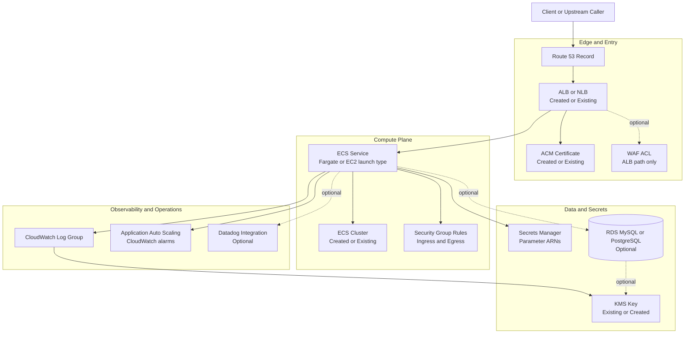
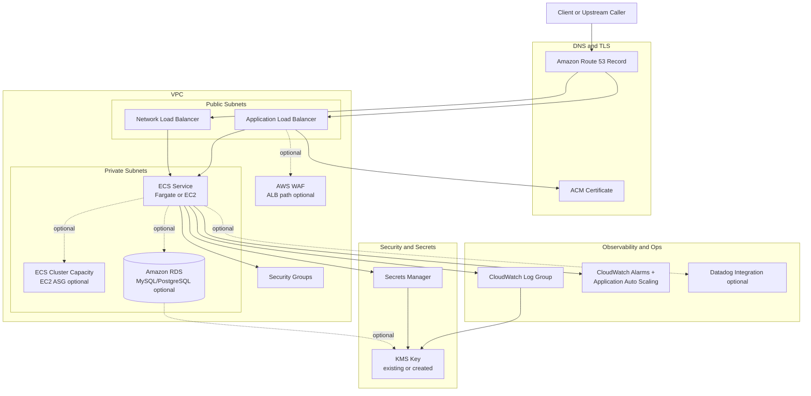
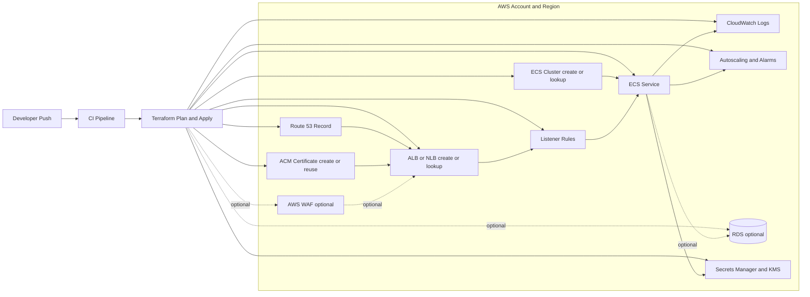
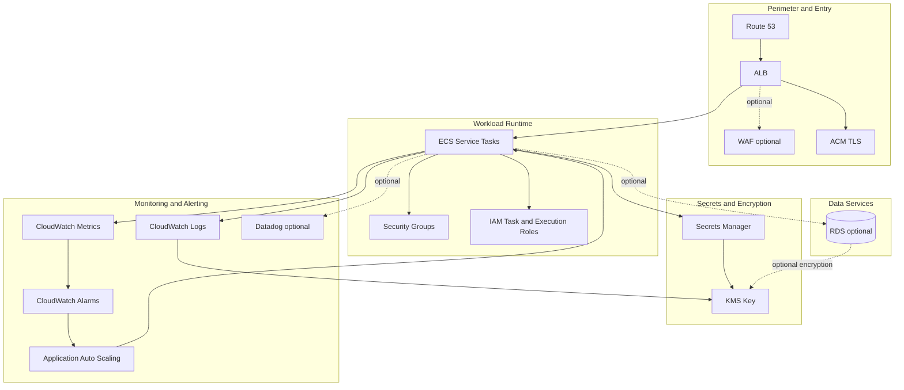
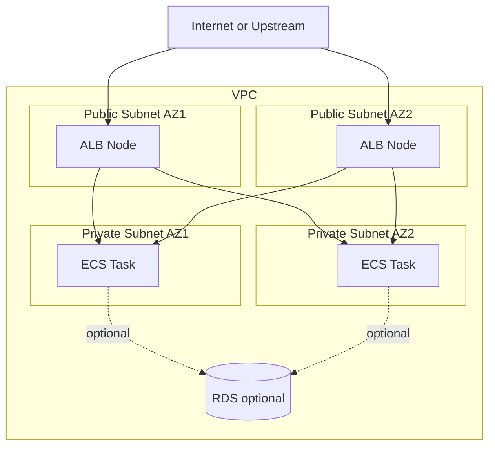

# ECS Blueprint Architecture Design

## Purpose
This document describes how the ECS Blueprint is designed, which cloud-native patterns it implements, and which AWS resources it provisions or integrates with. It is intended for developers and platform engineers who need to maintain, extend, or troubleshoot the blueprint.

## Design Goals
- Provide a reusable baseline for containerized workloads on ECS.
- Support both fully managed and bring-your-own (BYO) infrastructure models.
- Keep networking, security, observability, and scaling capabilities configurable by environment.
- Enforce guardrails with Terraform validations and sane defaults.

## High-Level Architecture

## AWS Service Architecture Diagram (Kiro-ready)

## AWS Deployment Flow Diagram (Kiro-ready)

## AWS Security and Observability Diagram (Kiro-ready)

## AWS Network Zoning Diagram (Kiro-ready)

## Cloud-Native Design Patterns Used

### 1. Immutable Container Deployments
- The service runs as ECS tasks with container image inputs.
- Task definitions are versioned and updated through infrastructure-as-code workflows.

### 2. Sidecar Pattern
- The blueprint supports multiple containers per task.
- Typical use includes application plus sidecar (for logging, tracing, metrics, proxies, or security agents).
- Optional Datadog sidecar/daemon integration is supported.

### 3. Stateless Service + Externalized State
- The ECS service is designed as a stateless compute tier.
- Optional durable state is provided by an external RDS database.

### 4. Decoupled Edge and Service Routing
- Traffic enters through ALB or NLB (or an existing LB), then routes to ECS target groups.
- Route 53 and ACM are composed independently, enabling DNS and TLS lifecycle flexibility.

### 5. Progressive Ownership (BYO vs Managed)
- You can create infrastructure in this blueprint or plug in existing ECS cluster, load balancer, WAF, and ACM certificate.
- This allows gradual migration from legacy stacks to blueprint-managed infrastructure.

### 6. Elastic Scaling Pattern
- ECS Service Auto Scaling is configurable with CloudWatch-based metrics and thresholds.
- Enables horizontal scaling of tasks based on demand.

### 7. Security-in-Depth
- Optional WAF in front of ALB.
- KMS-backed encryption options for logs and storage-related resources.
- Security group controls for inbound and outbound traffic.
- Secrets are injected into task definitions via ARN mappings.

### 8. Guardrail-Driven IaC
- Terraform preconditions validate key assumptions at plan/apply time (for example, container port and load balancer port alignment, OS/runtime compatibility).

## Resource Topology and Provisioning Logic

### Core Compute
- ECS service module is always used.
- ECS cluster can be:
  - Created by blueprint for Fargate workloads.
  - Created by blueprint for EC2-backed ECS workloads.
  - Reused from an existing cluster.

### Ingress and Traffic Management
- Load balancer can be ALB or NLB.
- Load balancer can be newly created or existing.
- Listener rules are managed through a dedicated listener-rules module.
- Additional security group rules are added for LB ingress/egress where required.

### DNS and TLS
- Route 53 record can be created for LB endpoints.
- ACM certificate can be created when using LB and no existing cert is supplied.
- Existing certificate ARN and hostname patterns are supported.

### Service Security and App Protection
- WAF ACL can be created and attached for ALB deployments.
- Existing WAF ACL can be associated instead of creating a new one.
- Platform roles and IAM role options support both generated and existing role names.

### Observability
- CloudWatch log group is provisioned for ECS logs.
- ECS Container Insights can be enabled/disabled/enhanced.
- Autoscaling alarms and custom CloudWatch alarms can be configured.
- Optional Datadog monitoring can be enabled.

### Data Layer (Optional)
- Optional RDS database provisioning (MySQL/Postgres engine options).
- Read replica, performance insights, backup, maintenance, and deletion-protection settings are exposed.
- Database secret ARNs can be merged into ECS task secret inputs.

### Encryption
- Existing KMS key ARNs can be used for logs/storage.
- Blueprint can create a KMS master key for CloudWatch when not supplied.

## Cloud Resources Used

The blueprint directly uses Terraform resources and data sources, and composes multiple internal Terraform modules that provision AWS services.

### Direct Terraform Resources
- aws_security_group_rule (ingress/egress rules for LB integration paths)
- aws_wafv2_web_acl_association (attach existing WAF ACL to ALB)
- terraform_data (input/runtime validations and configuration preconditions)

### Direct Terraform Data Sources
- aws_caller_identity
- aws_region
- aws_subnets
- aws_lb
- aws_ecs_cluster
- aws_route53_zone

### Composed AWS Service Modules
- ECS Cluster (Fargate)
- ECS Cluster (EC2)
- ECS Service
- Application Load Balancer (ALB)
- Network Load Balancer (NLB)
- Load Balancer Listener Rules
- Route 53 DNS Record
- ACM TLS Certificate
- CloudWatch Logs
- WAF ACL (Zscaler-integrated profile)
- RDS Database
- KMS Master Key
- Platform Roles helper

## Execution Paths (What Gets Created)

### Path A: Fully Managed Fargate Service
- Creates ECS cluster, ECS service, LB (ALB/NLB), listener rules, Route 53, ACM, CloudWatch logs.
- Optionally creates WAF, autoscaling, and RDS.

### Path B: Existing Cluster + New Service
- Reuses cluster.
- Creates ECS service and optional LB/DNS/TLS/observability/data components.

### Path C: Existing LB and/or Existing TLS/WAF
- Reuses provided LB and/or certificate/WAF.
- Still deploys ECS service and integration plumbing (target groups/listener rules as configured).

### Path D: No Load Balancer
- Deploys ECS service and related compute/observability/security controls without LB routing.

## Reliability and Operational Behavior
- Deployment safety is supported through ECS deployment circuit breaker and CloudWatch alarm rollback options.
- Steady-state waiting behavior is configurable for create/update/delete lifecycle.
- Health check configuration is mapped to LB mode, with protocol normalization for ALB/NLB differences.
- Optional availability zone rebalancing and autoscaling policies improve runtime resilience.

## Configuration Guardrails Important for Developers
- Container port must match LB-facing service port when LB is used.
- Runtime platform validations enforce compatible OS and task configuration (especially for Windows on EC2 launch type).
- Security group behavior changes depending on whether existing security groups are supplied.
- DNS behavior differs for private zone scenarios; public validation zone support is required for ACM challenges in private-zone use cases.

## Developer Guidance for Extending the Blueprint
- Add capabilities by composing additional modules rather than embedding large monolithic resource blocks.
- Keep optional features behind clear boolean switches with predictable defaults.
- Preserve existing BYO interfaces when adding new managed capabilities.
- Add tests in the test suite for each new conditional path (Fargate, EC2, LB types, WAF, DB, and existing-resource permutations).
- Document behavior changes in release notes and TechDocs pages to keep adoption safe.

## Related Repository Assets
- Visual architecture source diagram: _docs/diagrams/ECS_Blueprint.drawio
- Terraform implementation root: terraform/
- End-to-end validation tests: test/
